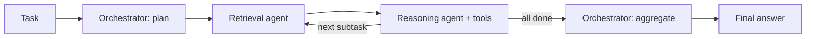

# Composing Cost-Reduction Techniques in Multi-Agent LLM Systems

[](https://github.com/ginoitaliano/cost-compose/actions/workflows/ci.yml)

[](LICENSE)

Repository description: Harness for measuring how semantic caching, model routing and early stopping compose in a multi-agent LLM pipeline (NeurIPS 2026 WiML).
Suggested GitHub topics: `llm`, `multi-agent`, `llm-inference`, `semantic-caching`, `model-routing`, `early-stopping`, `contextual-bandit`, `langgraph`, `benchmark`.

Code for *Composing Cost-Reduction Techniques in Multi-Agent LLM Systems: A Practitioner's Empirical Study* (Sarah Ahmed Altarouti, NeurIPS 2026 Workshop on Women in Machine Learning).

Semantic caching, model routing and early stopping each cut LLM cost by 22–50% in single-agent studies. Nobody has measured what happens when you turn them on together inside a multi-agent pipeline, where one agent's output is the next agent's input. This repo is the harness for that measurement: a reference RAG + tool-use pipeline, the three techniques as switchable components, and a runner that compares configurations on cost, latency and task success. It also includes a learned alternative to the paper's hand-set router: a contextual bandit that learns the cost/quality trade-off from task outcomes.

## The pipeline



Every LLM request from every node goes through one choke point (`Runtime.call_llm`) that routes it to a model, checks the cache, calls the provider and meters tokens and USD. Turning a technique on or off changes that choke point, not the agents.

| Config | Caching | Routing | Early stopping |
| --- | --- | --- | --- |
| `baseline` | | | |
| `cache_only` | ✓ | | |
| `route_only` | | ✓ | |
| `composed` | ✓ | ✓ | ✓ |

`configs/ablations/` adds configurations that isolate one mechanism each. None is in the paper's Table 1.

| Ablation | Extends | Change | Isolates |
| --- | --- | --- | --- |
| `cache_route` | `base` | caching + routing, no early stopping | H1 without a third technique |
| `early_stop_only` | `base` | early stopping only | early stopping's individual saving |
| `cache_only_pipeline` | `base` | `caching.scope: pipeline` | H2 (compare with `cache_only`) |
| `composed_model_aware` | `composed` | `caching.model_aware: true` | cross-model hits behind H1 |
| `composed_exclude_cached_drafts` | `composed` | `early_stopping.exclude_cached_drafts: true` | composition effect 4 |
| `composed_skip_tool_calls` | `composed` | `caching.skip_tool_calls: true` | savings from replayed action calls |
| `cache_only_guarded` | `cache_only` | all four cache guards on | false hits removed, caching alone |
| `composed_guarded` | `composed` | all four cache guards on | composition with the guarded cache |
| `cache_route_guarded` | `cache_route` | all four cache guards on | H1 with the guarded cache |
| `cache_only_role_scoped` | `cache_only` | `caching.role_scoped: true` | cross-role hits (plan served as the answer) |
| `cache_only_first_step` | `cache_only` | `caching.first_step_only: true` | hits replayed into the loop that wrote them |
| `cache_only_entity_guard` | `cache_only` | `caching.entity_guard: true` | hits for a different ID, number or date |
| `cache_only_skip_tool_calls` | `cache_only` | `caching.skip_tool_calls: true` | replayed tool calls, caching alone |
| `single_agent_baseline` | `base` | `mode: single_agent` | H3 single-agent arm, no techniques |
| `single_agent_route` | `single_agent_baseline` | routing on | H3 single-agent routing drop |
| `learned_route` | `route_only` | `routing.policy: linucb` | learned vs heuristic routing |
| `composed_learned` | `composed` | `routing.policy: linucb` | learned routing under composition |

`make run` runs what the paper needs: the four Table 1 configs plus `cache_route`, `cache_only_pipeline`, `composed_model_aware`, the two single-agent configs and the three guarded-cache configs. `make run-extended` runs the other nine ablations, including one cache guard at a time, into the same output directory, and the report covers whatever has been run. Both targets use explicit lists in the Makefile, and a test fails if a file in `configs/ablations/` is in neither list or in both.

## What it measures

| Hypothesis | Mechanism instrumented | Where to look |
| --- | --- | --- |
| H1: caching + routing saves less than independent composition predicts | Cross-model cache hits: an answer cached from one model served to a request routed to another | `hypotheses.H1_sub_additive.primary_independence_test` (interaction term and 95% CI), `secondary_sum_of_savings`, `cross_model_hit_share` |
| H2: pipeline-level caching hits less than agent-level | Pipeline-scope keys include upstream agent outputs, so upstream drift changes the key | `hypotheses.H2_pipeline_vs_agent_cache`, `cache_hit_rate_by_agent` |
| H2, correctness side: hits that serve the wrong entry | Each cache entry stores the IDs, numbers and dates in its request; a hit whose entities differ from the incoming request is an entity-mismatch hit | `configs.<name>.cache_correctness` (hit rate, entity-mismatch share of hits, success given hit vs miss, per scope), "Cache correctness" in `summary.md` |
| H3: routing hurts high-complexity tasks more in multi-agent settings than in a single agent | Per-stratum success drop under routing for the multi-agent pipeline (`baseline` -> `route_only`) and a measured single agent (`single_agent_baseline` -> `single_agent_route`) | `hypotheses.H3_routing_success_drop` (`multi_agent`, `single_agent`, each with `high_minus_low`; `multi_minus_single`), all with 95% CIs |
| Cache false-hit mechanisms in a pipeline | Every cache entry records the task run, reasoning loop and role that wrote it. Each hit is classified as same loop (served back into the loop that wrote it), same task (elsewhere in the task run) or cross task (from an earlier task, the reuse a semantic cache is for), and flagged when it crosses roles or when the question's or subtask's entities differ | `configs.<name>.cache_correctness.mechanisms` (share of hits by origin, success given a hit by origin, cross-role share, query-entity mismatch share, guard refusals, bypassed requests), "Cache hits by mechanism" in `summary.md` |
| H1 with the guarded cache | The H1 test repeated with `cache_only_guarded` and `cache_route_guarded`: whether the caching x routing interaction survives once those false hits are removed | `hypotheses.H1_guarded_cache` |
| Routing score distribution | Complexity score of every request by role, against the ladder cutoffs | `configs.<name>.routing_scores`, "Routing scores" in `summary.md` |
| Effect 4 (not in the paper): cache-induced early stops | A cached draft replayed into a refinement step makes consecutive drafts agree and fires the stop rule. Counted when the stop fires on all drafts but would not fire with cached drafts removed | `cache_induced_early_stops` per task, `hypotheses.E4_cache_induced_early_stops`; ablation `composed_exclude_cached_drafts` |

Why H1 is tested against independence, not the sum. Let caching alone save a fraction a of baseline cost and routing alone save b. If the two act independently (caching removes a share of calls, routing makes the remaining calls cheaper), the composed saving is 1 − (1 − a)(1 − b) = a + b − ab. For any two positive savings that is below a + b, so composition is always sub-additive against the sum of savings, and finding it says nothing about interference. The primary H1 test is therefore against the independence prediction `1 − (1 − s_cache)(1 − s_route)`. The report gives the interaction term, observed composed saving minus the independence prediction, with a 95% paired bootstrap CI over tasks: a CI below zero means the techniques interfere, above zero means they reinforce each other, and a CI containing zero is consistent with independence. The comparison against the sum of savings, which is how the paper states H1, is kept as a secondary figure and labelled as such.

Per task the runner records the following. Everything after the first item is new in this version and defaults to 0 or null; existing configurations produce the same values for the original fields.

- Cost (at each model's price and at GPT-4o-equivalent price), wall-clock latency, success, LLM calls vs cache hits by agent, cross-model hits, routing decisions, reasoning iterations, early stops and tool calls.
- `entity_mismatch_hits`, `entity_mismatch_hits_by_agent`: cache hits served from an entry whose request had different IDs, numbers or dates.
- `cached_drafts`, `cached_draft_replays`, `cache_induced_early_stops`: reasoner drafts served from the cache, those repeating an earlier draft's answer in the same loop, and early stops that only fired because of cached drafts.
- `tool_call_responses_not_cached`: responses withheld from the cache by `caching.skip_tool_calls`.
- `cache_lookups`, `cache_bypassed`: requests that looked up the cache, and requests that skipped it under `caching.first_step_only`. Hit rates use `cache_lookups` as the denominator (equal to `requests` when no step is bypassed).
- `hits_by_origin`, `hits_by_role`, `lookups_by_role`, `cross_role_hits`, `query_entity_mismatch_hits`, `entity_guard_refusals`: the hit-mechanism accounting above.
- `routing_scores`: `[role, score]` for every request, routed or not.
- `mode`, `cache_scope`: pipeline mode and cache scope of the configuration.

Statistics. The headline comparisons are paired over tasks, because every configuration runs the same tasks with the same seeds. Success is compared with an exact McNemar test on (task, seed) pairs, plus the success-rate difference with a 95% paired bootstrap CI over tasks. Cost and latency differences use a paired bootstrap over tasks, with each task's value averaged over its seeds (10,000 resamples, fixed seed, 95% percentile CIs). Every config is compared with `baseline`, and each ablation with the config it modifies. The H3 strata are resampled within stratum. Seed-level mean ± std, P50/P95 latency and success by stratum are still reported as per-config descriptives. Every rate in the report is printed with its sample size.

## Learned routing (RL)

The paper's router scores each subtask with fixed weights and thresholds. `routing.policy: linucb` replaces it with a disjoint LinUCB contextual bandit: one arm per model on the ladder, context = the same four complexity features plus a bias term. It learns online, task by task, from

```
reward = 1[task succeeded] − λ · (call cost / same tokens at GPT-4o price)
```

with λ = `routing.bandit.cost_weight` (0.5 by default). Task success is only observed at the end, so every routing decision in a task shares it; the cost term is per call, so cost credit lands on the model that incurred it. Decisions answered from the cache are excluded from updates because the chosen model never ran.

Two questions this answers that the heuristic can't:

- Does a learned policy find a better cost/success frontier than hand-set thresholds? (`learned_vs_heuristic_routing` in the report)
- Does a policy trained under caching and early stopping learn around the interference behind H1? (`composed_learned` vs `composed`)

The report includes a learning curve (success and cost per quarter of the task stream) for each learned configuration, and the runner saves each policy's final state (per-arm pulls, mean reward, linear weights) to `results/<run>/policies/`. The weights show which complexity features the policy learned to route on.

## Quickstart (no API keys)

```bash
git clone https://github.com/ginoitaliano/cost-compose
cd cost-compose
pip install -e ".[dev]"
make test
make dry-run
```

The repository is named `cost-compose`. The Python distribution, the import path (`import costcompose`) and the CLI entry point (`costcompose`) are all `costcompose`, without the hyphen.

`--dry-run` swaps in a deterministic offline model and embedder. It exercises every code path (planning, tool calls, caching, routing, early stopping, reporting) in seconds. Its numbers are a plumbing check, not results.

## Full run

The experiments run on a Lightning AI Studio GPU, which also serves Llama-3.1-8B locally.

```bash
pip install -e ".[all]"
cp .env.example .env                       # OpenAI, Anthropic, LangSmith, Hugging Face keys
set -a; . ./.env; set +a                   # the CLI does not read .env itself; export it
docker run -d -p 6379:6379 redis:7-alpine  # cache backend
./scripts/serve_llama.sh &                 # vLLM on 127.0.0.1:8000, one GPU; needs HF_TOKEN with Llama 3.1 access

# Task suite, 40 per stratum: every eligible GAIA task, your enterprise tasks
# (data/tasks/enterprise.jsonl, if present) and MuSiQue filling the rest
make suite                                 # MUSIQUE_INPUT=path/to/musique_ans_v1.0_dev.jsonl for the official file

make run            # Table 1 + the ablations H1-H3 need, seeds 0 1 2 -> results/full/
make run-extended   # optional: the other ablations, appended to results/full/
make report         # rebuild summary.md / summary.json from runs.jsonl
make spotcheck      # 10% human spot-check sample -> results/full/spotcheck.csv

# Reuse stream: the caching configs on a suite where some subtasks recur across tasks
make suite-reuse    # data/tasks/suite_reuse.jsonl, corpus in data/corpus_reuse/ (REUSE_SHARE=0.5)
make run-reuse      # -> results/full_reuse/
```

GAIA tasks come from the validation split only, because it is the only split with public answers. `prepare_gaia.py` excludes tasks the pipeline cannot attempt. Its tools are a calculator and search over the local corpus, so it drops tasks that need web browsing, tasks with an attached file it cannot read (any attachment by default; `--readable-extensions` allows some), and tasks that need multimodal input. The decision uses GAIA's metadata: the `file_name` field and the annotators' tool list, plus URLs or YouTube links in the question. Exclusion counts by reason are printed and written to `<out>.exclusions.json`, which holds counts only, no task content. Tasks with no annotator tool list are kept and counted so they can be reviewed by hand. If fewer eligible tasks remain than requested, the script warns rather than padding. In practice only 18 of the 165 validation tasks qualify (8 low, 6 medium, 4 high): 123 need web browsing, 41 need multimodal input and 25 have attachments (a task can have several reasons).

MuSiQue fills the gap. It is multi-hop question answering over Wikipedia paragraphs (Trivedi et al., TACL 2022; CC BY 4.0), built from 2, 3 or 4 single-hop questions where each later hop depends on an earlier answer, which is the dependency chain the pipeline is built around. Hop count sets the stratum: 2 hops low, 3 medium, 4 high. `scripts/prepare_musique.py` uses the dev split of MuSiQue-Ans (answerable questions; the test split's answers are not public), counts the tasks already in the suite per stratum, and takes a seeded selection of MuSiQue questions to fill each stratum to 40. A smaller selection is always a prefix of a larger one, so adding enterprise tasks later only removes MuSiQue tasks from the end. Each selected question's 20 paragraphs (supporting and distractors) go into `data/corpus/musique/`, deduplicated, and all questions share that corpus. Accepted answer aliases are kept, and both scores accept any of them.

Reuse stream. In a suite of unrelated questions a correct cache has almost nothing to reuse: in a 12-task pilot with every cache guard on, the hit rate fell from 41% to 4% and no hit came from an earlier task, so the unguarded cache's saving was within-task false hits. MuSiQue questions are composed from single-hop questions that carry IDs, and different questions reuse the same hop: 2,173 of the 2,417 dev questions share at least one hop with another. `prepare_musique.py --reuse-share r` draws a share r of each stratum's MuSiQue tasks as clusters of 2 to `--cluster-max` (default 3) questions that share a hop, and fills the rest with the plain seeded selection. The questions differ, but some of their subtasks recur across tasks, which is the reuse a cache inside a pipeline can serve correctly. `--reuse-share 0` (the default) is the plain selection, unchanged. `make suite-reuse` builds the reuse stream with r = 0.5 into its own task file and corpus directory, keeping the GAIA and enterprise tasks and the 40/40/40 strata, and `make run-reuse` runs the caching configurations on it into `results/full_reuse/`. Every log records how many selected tasks share a hop with another selected task (`hop_sharing`), so the main suite's incidental reuse is measured as well, and the reuse log lists every cluster. The log next to the output records counts per stratum and the input file's SHA-256, so the exact data can be checked against the official release from StonyBrookNLP/musique.

Human spot-checks (paper §3.4) check the automated scorer. `costcompose spotcheck sample results/full --tasks data/tasks/suite.jsonl` draws a seeded 10% of task IDs per complexity stratum (4 per stratum at 40/40/40) and one seed per sampled task. It writes a CSV row for every config that ran that task and seed, so scorer errors that depend on the config show up. It will not overwrite an existing CSV without `--force`. Fill `human_success` with 1 or 0, then `costcompose spotcheck score results/full/spotcheck.csv` reports agreement and Cohen's kappa against `auto_success`, overall and per config with n, and lists the disagreements. The CSV holds task questions, and for GAIA tasks it must not be published; `results/` is git-ignored.

Before the first task, a run calls every model its configs can use once, plus the embedder, and stops with a list of the ones that failed (`--skip-preflight` turns this off). A missing key or a stopped Llama server then costs seconds, not a column of failed tasks.

Runs are resumable: `runs.jsonl` is appended one task at a time, and a rerun skips every (config, seed, task) already recorded. A task that raises an error is logged with it and scored as a failure rather than stopping the run. On a rerun, those errored task runs are moved to `runs.errors.jsonl` and retried, so an outage is not counted as a configuration's failure; a task that errors again is recorded again. `--no-retry-errors` keeps them instead.

Run any subset directly:

```bash
costcompose run --configs baseline composed --tasks data/tasks/suite.jsonl \
  --corpus data/corpus --seeds 0 1 2 --out results/full
costcompose validate --tasks data/tasks/suite.jsonl
```

## Configuration

All settings live in `configs/base.yaml`; each configuration `extends:` it and overrides only what differs. The paper's values:

| Setting | Value |
| --- | --- |
| Cache similarity threshold | 0.92 cosine, `text-embedding-3-small` |
| Cache scope | `agent` (per-agent namespace, local input) or `pipeline` (shared, input + upstream context) |
| Routing features | query length, tool-call count, context size, dependency depth; equal weights |
| Routing ladder | Llama-3.1-8B < 0.25 ≤ Haiku 4.5 < 0.5 ≤ GPT-4o < 0.75 ≤ Sonnet 4.5 |
| Low tier | score < 0.5 (Llama-3.1-8B, Haiku 4.5) |
| Early-stopping threshold | 0.88 on 0.5 × self-reported confidence + 0.5 × draft consistency (stop when it exceeds the threshold) |
| Router policy | `heuristic` (paper) or `linucb`; bandit α = 1.0, ridge = 1.0, λ = 0.5 |
| Seeds | 0, 1, 2 (seed also shuffles task order, which sets what the cache has seen) |

Settings added in this version. Each defaults to the paper setup, so existing configurations reproduce exactly.

| Setting | Default | Effect when changed |
| --- | --- | --- |
| `mode` | `multi_agent` | `single_agent`: one reasoning agent with `search_docs` and the calculator as functions, no orchestrator or retriever. Same `Runtime.call_llm` choke point and reasoning loop. Its dependency-depth routing feature is always 0. |
| `caching.skip_tool_calls` | `false` | `true`: a response containing a tool or function call with arguments is never stored or served. Plans, retrieval summaries and final text are still cached. |
| `caching.version_key` | `null` | Added to the cache namespace in both scopes, so a change invalidates earlier entries. `prompts` hashes the system prompts, `file:<path>` hashes a file, any other value is used as given. |
| `caching.role_scoped` | `false` | `true`: one cache namespace per role rather than per agent. The orchestrator plans and aggregates; without this an aggregation request can be served the stored plan. In `pipeline` scope it splits the shared namespace by role. |
| `caching.first_step_only` | `false` | `true`: only the first step of each reasoning loop looks up or writes the cache. Later steps differ from earlier ones only by a tool result or a refinement request appended to a long input, so without this a step can be served the response its own loop produced one step earlier. |
| `caching.entity_guard` | `false` | `true`: a hit is refused, and the model called, when the IDs, numbers or dates in the request's question or subtask differ from those of the stored request. Retrieved passages are not compared. |
| `early_stopping.exclude_cached_drafts` | `false` | `true`: drafts served from the cache are left out of the stop rule (both the self-reported confidence and the consistency term). |

Prices are in `configs/base.yaml` as USD per million tokens. Check them against current provider pricing before a paid run, and set the self-hosted Llama price from your GPU rate and measured throughput.

Tasks are JSONL:

```json
{"id": "ent-042", "question": "...", "answer": "750", "complexity": "medium", "source": "enterprise"}
```

Each task gets two scores. Strict success (`success_strict`) is GAIA-style quasi-exact match: numbers compared numerically after removing `$`, `%` and thousands separators, strings normalised, lists element-wise; anything after a number fails it. Primary success (`success`) is the same, except that a number may be followed by unit words the question itself names: `95 USD` counts for a question ending "in USD", while `1 day` for a question asking "in hours", a different currency, scale words (`thousand`) and hedges (`approx.`) do not. The primary score keeps success from depending on whether a model obeys an instruction to drop units, which differs by model and would bias routing comparisons; the first real-model smoke test showed GPT-4o adding units to 8 of 9 correct answers. The rule was fixed before any study data was collected. The report puts both side by side and repeats the paired success tests under each, so any conclusion that depends on formatting is visible.

An optional judge audits the scorer without changing it. `costcompose judge results/full --tasks data/tasks/suite.jsonl --model <id> --api-base <url>` asks an independent model whether each answer means the same as the reference, for the runs where primary and strict disagree (add `--include-spotcheck results/full/spotcheck.csv` to judge the human-graded sample too). It reports agreement and Cohen's kappa with each score, overall and per config, in `judge_agreement.json`. The judge must not be on the routing ladder; the command refuses GPT-4o, Claude and Llama-3.1, since a model grading its own family's answers tends to favour them. A self-served open model from another family fits, served on its own port with vLLM after the study run (stop the Llama server first or give each a share of the GPU with `--gpu-memory-utilization`). Nothing it does changes `runs.jsonl` or any reported success rate.

Documents for retrieval go in `--corpus` as `.md` or `.txt`; subfolders are read too. `data/corpus/sample/` holds the three documents behind the sample tasks, which the tests and `make dry-run` use on their own so their results do not change when other corpora are added. Full runs use all of `data/corpus/`: the sample documents, `musique/` and your enterprise documents.

## Layout

```
src/costcompose/
  agents.py       runtime choke point + plan / retrieve / reason / aggregate / single-agent nodes
  pipeline.py     LangGraph and native engines (multi- and single-agent), single-task execution
  cache.py        semantic cache, agent/pipeline scope, entity extractor, memory/Redis backends
  routing.py      complexity features, heuristic router, LinUCB bandit router
  early_stop.py   confidence parsing, draft consistency, stop rule
  llm.py          LiteLLM clients + offline fake client and hashing embedder
  tracking.py     per-call cost and token accounting
  analysis.py     paired tests (McNemar, bootstrap), H1-H3 and effect 4, Markdown report
  experiment.py   resumable configs x seeds x tasks runner
  spotcheck.py    human spot-check sampling and scorer agreement
  judge.py        optional off-ladder LLM-judge audit of the scorer
  cli.py          costcompose run | report | validate | spotcheck | judge
configs/          Table 1 configurations and ablations
data/             sample corpus and tasks (GAIA and MuSiQue are fetched, never committed)
scripts/          vLLM server, GAIA subset builder and filter
paper/            the paper and a section-to-code map
```

## Implementation notes

The cache is GPTCache-style, reimplemented for per-scope keys and cross-model hit accounting. It does not use the GPTCache library. It follows GPTCache's design (embed, nearest neighbour, cosine threshold, Redis store), but the study needs control GPTCache does not expose: per-agent vs pipeline-wide key construction, counting hits that cross model boundaries, entity-mismatch accounting, hit-origin accounting and the pipeline guards.

Early stopping is a loop-level stop rule inspired by CALM (Schuster et al. 2022), not CALM itself. CALM is token-level early exit: for each generated token it decides how many decoder layers to run. Here the rule decides whether to run another iteration of an agent's reasoning loop, from the model's self-reported confidence and the agreement between consecutive drafts.

The entity extractor is a small set of regular expressions (dates, identifiers such as `ORD-48213` or `#5521`, numbers). It reads the agent's whole local input, including retrieved passages and tool transcripts, so it errs toward flagging a hit as a mismatch. It also misses differences its patterns do not cover, such as names. Self-reported `CONFIDENCE:` values are ignored. Read the entity-mismatch share as an indicator of wrong-entry hits, not as an exact count or a bound.

Both engines call the same node functions. LangGraph is the default when installed and is what LangSmith traces; the native engine exists so the core runs and tests with only NumPy and PyYAML. CI checks that both produce the same answers, call counts, cache hits, hit origins, guard refusals, bypassed requests, routing and routing scores, early stops, cache-induced stops and entity-mismatch hits, in `multi_agent` mode with the naive and the guarded cache and in `single_agent` mode.

In the reasoning loop, every tool call is written into the conversation as its own assistant turn followed by its result, even when a model requested several in one response. Some chat templates (Llama 3.1's) reject a turn with more than one tool call, and with routing, the step after a GPT-4o or Claude call that used parallel tools can go to Llama. Every provider accepts the one-call-per-turn form, so all configurations use it.

Routing features use a 4-characters-per-token estimate. Billing uses the token counts the provider returns.

The guarded cache. With all guards off, the cache is wired the way semantic caches are usually dropped into agent frameworks: each agent's input is the key and every request is cached. In a pilot run (12 tasks) that produced three kinds of false hit inside a single task: the aggregator served the orchestrator's own plan as the final answer, reasoning-loop steps served their own previous tool call back (one task ran the calculator 100 times), and hits for questions with different IDs, numbers or dates. The four guards each follow a practice from deployed semantic caches, adapted to a pipeline: partitioning the cache by role, as production caches partition by application, user or intent; caching only the first turn of a multi-turn exchange and never function-call turns, as Redis's integration for Google ADK does; and refusing hits whose numbers or identifiers differ, as condition checks in recent semantic-cache work do. None needs an LLM verifier or changes the 0.92 threshold. Both caches are run: the unguarded one is the default and the naive arm, the guarded one is a separate set of configurations, and one-guard ablations attribute the change to each guard.

Semantic caching inside the reasoning loop can replay an earlier draft to a refinement step. By default that is counted, not suppressed: it is one of the composition effects the study is looking for (`cache_induced_early_stops`). `early_stopping.exclude_cached_drafts: true` suppresses it for the ablation.

The learned router pays for exploration early in the task stream: it has to try expensive models to learn when they are worth it. On a 120-task suite that is a real share of the run, so read its learning curve alongside the averages. Keep α at 1.0 or above; with rewards on this scale, smaller values can lock onto the first arm that looks acceptable.

## Results

Experiments are in progress. Results will be published here and in the paper.

## Citation

```bibtex
@inproceedings{altarouti2026composing,
  title     = {Composing Cost-Reduction Techniques in Multi-Agent {LLM} Systems: A Practitioner's Empirical Study},
  author    = {Altarouti, Sarah Ahmed},
  booktitle = {NeurIPS 2026 Workshop on Women in Machine Learning (WiML)},
  year      = {2026}
}
```

## License

MIT
