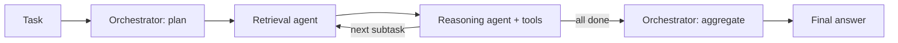

# Composing Cost-Reduction Techniques in Multi-Agent LLM Systems

[](https://github.com/YOUR_GITHUB_USERNAME/costcompose/actions/workflows/ci.yml)

[](LICENSE)

Code for *Composing Cost-Reduction Techniques in Multi-Agent LLM Systems: A Practitioner's Empirical Study* (Sarah Ahmed Altarouti, NeurIPS 2026 Workshop on Women in Machine Learning).

Semantic caching, model routing and early stopping each cut LLM cost by 22–50% in single-agent studies. Nobody has measured what happens when you turn them on together inside a multi-agent pipeline, where one agent's output is the next agent's input. This repo is the harness for that measurement: a reference RAG + tool-use pipeline, the three techniques as switchable components, and a runner that compares configurations on cost, latency and task success. It also includes a learned alternative to the paper's hand-set router: a contextual bandit that learns the cost/quality trade-off from task outcomes.

## The pipeline



Every LLM request from every node goes through one choke point (`Runtime.call_llm`) that routes it to a model, checks the cache, calls the provider and meters tokens and USD. Turning a technique on or off changes that choke point, not the agents.

| Config | Caching | Routing | Early stopping |
| --- | --- | --- | --- |
| `baseline` | | | |
| `cache_only` | ✓ | | |
| `route_only` | | ✓ | |
| `composed` | ✓ | ✓ | ✓ |

`configs/ablations/` adds `cache_route` (caching + routing, no early stopping), `early_stop_only`, `cache_only_pipeline` (pipeline-scope cache keys) and `composed_model_aware`. These isolate each hypothesis. `learned_route` and `composed_learned` swap in the learned router.

## What it measures

| Hypothesis | Mechanism instrumented | Where to look |
| --- | --- | --- |
| H1: caching + routing saves less than the sum of each alone | Cross-model cache hits: an answer cached from one model served to a request routed to another | `hypotheses.H1_sub_additive`, `cross_model_hit_share` |
| H2: pipeline-level caching hits less than agent-level | Pipeline-scope keys include upstream agent outputs, so upstream drift changes the key | `hypotheses.H2_pipeline_vs_agent_cache`, `cache_hit_rate_by_agent` |
| H3: routing hurts high-complexity tasks more in multi-agent settings | Success rate per complexity stratum, routed vs baseline | `hypotheses.H3_routing_success_drop`, `success_by_complexity` |

H1 is reported against two baselines: the sum of individual savings (the paper's framing) and the independent-composition prediction `1 − (1 − s_cache)(1 − s_route)`. Savings that compose independently already fall short of the sum, so the second is the stricter test.

Per task the runner records cost (at each model's price and at GPT-4o-equivalent price), wall-clock latency, success, LLM calls vs cache hits by agent, routing decisions, reasoning iterations, early stops and tool calls. Per configuration it reports mean ± std across seeds, P50/P95 latency and success by stratum.

## Learned routing (RL)

The paper's router scores each subtask with fixed weights and thresholds. `routing.policy: linucb` replaces it with a disjoint LinUCB contextual bandit: one arm per model on the ladder, context = the same four complexity features plus a bias term. It learns online, task by task, from

```
reward = 1[task succeeded] − λ · (call cost / same tokens at GPT-4o price)
```

with λ = `routing.bandit.cost_weight` (0.5 by default). Task success is only observed at the end, so every routing decision in a task shares it; the cost term is per call, so cost credit lands on the model that incurred it. Decisions answered from the cache are excluded from updates because the chosen model never ran.

Two questions this answers that the heuristic can't:

- Does a learned policy find a better cost/success frontier than hand-set thresholds? (`learned_vs_heuristic_routing` in the report)
- Does a policy trained under caching and early stopping learn around the interference behind H1? (`composed_learned` vs `composed`)

The report includes a learning curve (success and cost per quarter of the task stream) for each learned configuration, and the runner saves each policy's final state (per-arm pulls, mean reward, linear weights) to `results/<run>/policies/`. The weights show which complexity features the policy learned to route on.

## Quickstart (no API keys)

```bash
git clone https://github.com/YOUR_GITHUB_USERNAME/costcompose
cd costcompose
pip install -e ".[dev]"
make test
make dry-run
```

`--dry-run` swaps in a deterministic offline model and embedder. It exercises every code path (planning, tool calls, caching, routing, early stopping, reporting) in seconds. Its numbers are a plumbing check, not results.

## Full run

The experiments run on a Lightning AI Studio GPU, which also serves Llama-3-8B locally.

```bash
pip install -e ".[all]"
cp .env.example .env                       # OpenAI, Anthropic, LangSmith keys
docker run -d -p 6379:6379 redis:7-alpine  # cache backend
./scripts/serve_llama.sh &                 # vLLM, OpenAI-compatible, port 8000

# Task suite: 60 GAIA tasks + your enterprise RAG tasks, 40 per stratum in total
python scripts/prepare_gaia.py --per-stratum 20 --out data/tasks/gaia_subset.jsonl
cat data/tasks/gaia_subset.jsonl data/tasks/enterprise.jsonl > data/tasks/suite.jsonl

make run      # Table 1 configs + ablations, seeds 0 1 2 -> results/full/
make report   # rebuild summary.md / summary.json from runs.jsonl
```

Runs are resumable: `runs.jsonl` is appended one task at a time, and a rerun skips every (config, seed, task) already recorded. A failed task is logged with its error and scored as a failure rather than stopping the run.

Run any subset directly:

```bash
costcompose run --configs baseline composed --tasks data/tasks/suite.jsonl \
  --corpus data/corpus --seeds 0 1 2 --out results/full
costcompose validate --tasks data/tasks/suite.jsonl
```

## Configuration

All settings live in `configs/base.yaml`; each configuration `extends:` it and overrides only what differs. The paper's values:

| Setting | Value |
| --- | --- |
| Cache similarity threshold | 0.92 cosine, `text-embedding-3-small` |
| Cache scope | `agent` (per-agent namespace, local input) or `pipeline` (shared, input + upstream context) |
| Routing features | query length, tool-call count, context size, dependency depth; equal weights |
| Routing ladder | Llama-3-8B < 0.25 ≤ Haiku 4.5 < 0.5 ≤ GPT-4o < 0.75 ≤ Sonnet 4.5 |
| Low tier | score < 0.5 (Llama-3-8B, Haiku 4.5) |
| Early-stopping threshold | 0.88 on 0.5 × self-reported confidence + 0.5 × draft consistency |
| Router policy | `heuristic` (paper) or `linucb`; bandit α = 1.0, ridge = 1.0, λ = 0.5 |
| Seeds | 0, 1, 2 (seed also shuffles task order, which sets what the cache has seen) |

Prices are in `configs/base.yaml` as USD per million tokens. Check them against current provider pricing before a paid run, and set the self-hosted Llama price from your GPU rate and measured throughput.

Tasks are JSONL:

```json
{"id": "ent-042", "question": "...", "answer": "750", "complexity": "medium", "source": "enterprise"}
```

Scoring is GAIA-style quasi-exact match: numbers compared numerically, strings normalised, lists element-wise. Documents for retrieval go in `--corpus` as `.md` or `.txt`.

## Layout

```
src/costcompose/
  agents.py       runtime choke point + plan / retrieve / reason / aggregate nodes
  pipeline.py     LangGraph and native engines, single-task execution
  cache.py        semantic cache, agent/pipeline scope, in-memory and Redis backends
  routing.py      complexity features, heuristic router, LinUCB bandit router
  early_stop.py   confidence parsing, draft consistency, stop rule
  llm.py          LiteLLM clients + offline fake client and hashing embedder
  tracking.py     per-call cost and token accounting
  analysis.py     per-seed stats, hypothesis checks, Markdown report
  experiment.py   resumable configs x seeds x tasks runner
  cli.py          costcompose run | report | validate
configs/          Table 1 configurations and ablations
data/             sample corpus and tasks (GAIA is fetched, never committed)
scripts/          vLLM server, GAIA subset builder
paper/            the paper and a section-to-code map
```

## Implementation notes

The cache is implemented here rather than wrapped from GPTCache. It follows GPTCache's design (embed, nearest neighbour, cosine threshold, Redis store), but the study needs control GPTCache doesn't expose: per-agent vs pipeline-wide key construction and counting hits that cross model boundaries.

Both engines call the same node functions. LangGraph is the default when installed and is what LangSmith traces; the native engine exists so the core runs and tests with only NumPy and PyYAML. CI checks that both produce the same answers, call counts, cache hits and routing.

Routing features use a 4-characters-per-token estimate. Billing uses the token counts the provider returns.

Semantic caching inside the reasoning loop can replay an earlier draft to a refinement step. That is counted, not suppressed: it is one of the composition effects the study is looking for.

The learned router pays for exploration early in the task stream: it has to try expensive models to learn when they are worth it. On a 120-task suite that is a real share of the run, so read its learning curve alongside the averages. Keep α at 1.0 or above; with rewards on this scale, smaller values can lock onto the first arm that looks acceptable.

## Results

Experiments are in progress. Results will be published here and in the paper.

## Citation

```bibtex
@inproceedings{altarouti2026composing,
  title     = {Composing Cost-Reduction Techniques in Multi-Agent {LLM} Systems: A Practitioner's Empirical Study},
  author    = {Altarouti, Sarah Ahmed},
  booktitle = {NeurIPS 2026 Workshop on Women in Machine Learning (WiML)},
  year      = {2026}
}
```

## License

MIT
